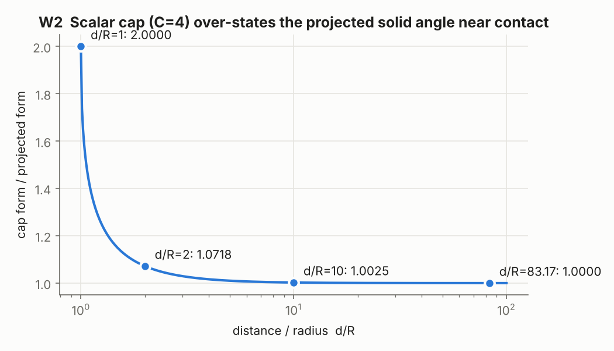
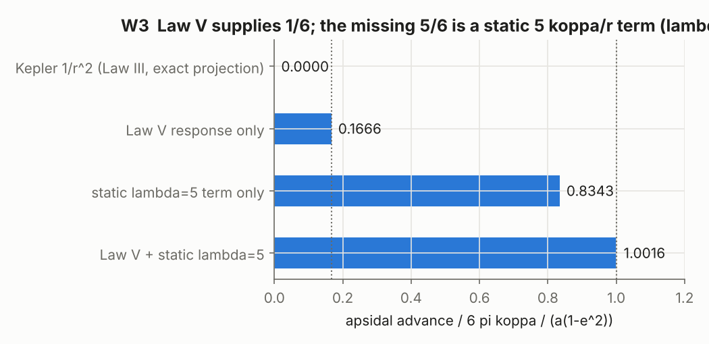
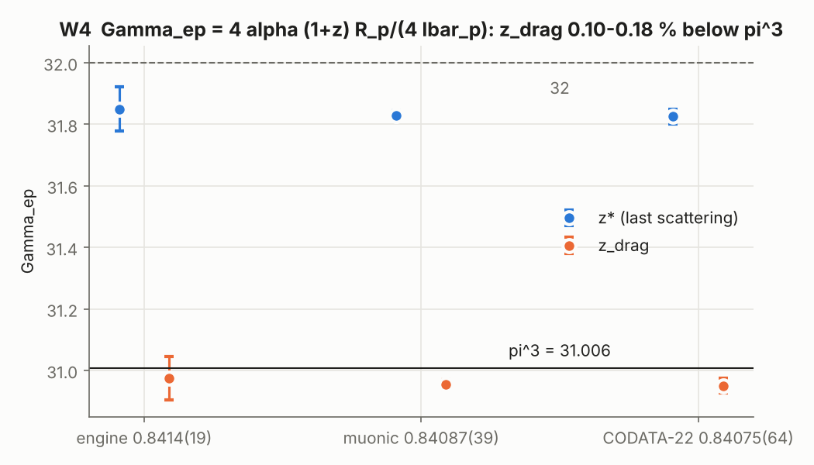
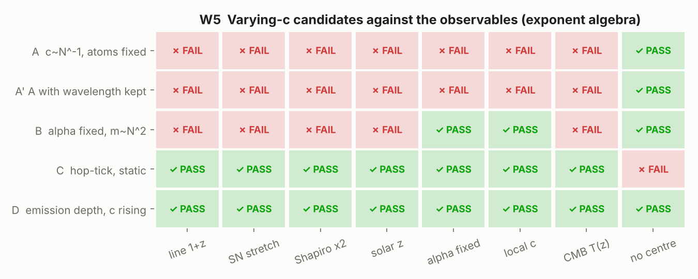
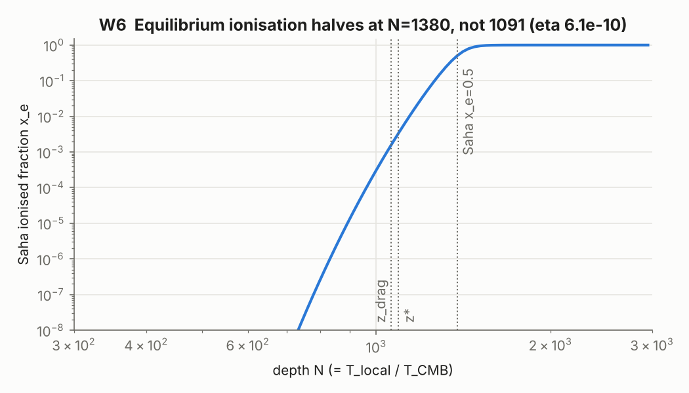
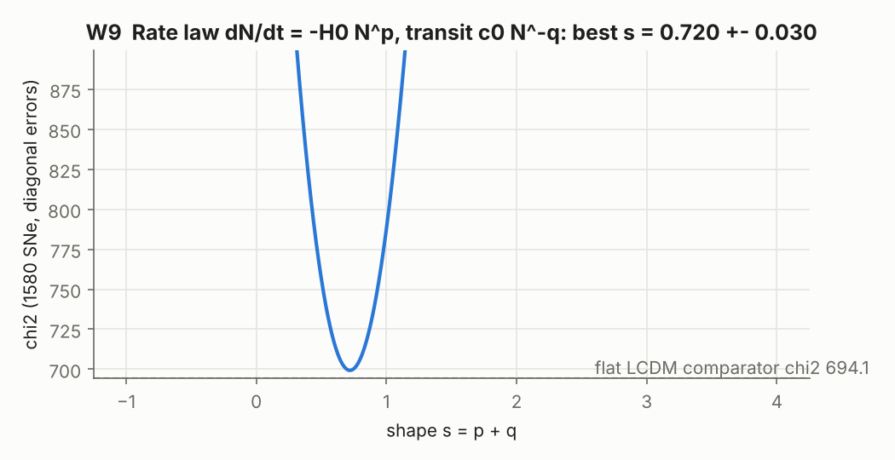
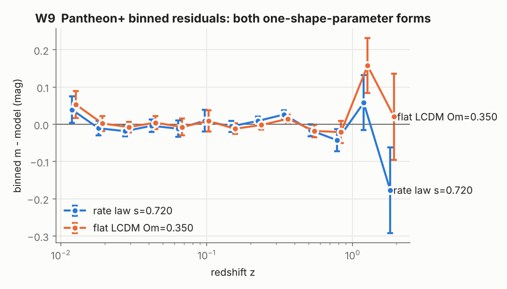

# Common Spaz Metric run 2 — result tables

Every number comes from `spaz_audit2.cpp`, `spaz_precession2.cpp` or `spaz_models2.cpp`; the raw outputs are in
`*_output2.txt`. Each number carries one label. A quoted claim from an audited text is CLAIM.

---

## W1 — pasted "Complete Quantum Mechanics Derivation"

| Step | CLAIM | COMPUTED | Verdict |
|---|---|---|---|
| E_p(r_e) = 1 − e⁻¹ | 0.63212055883 | 0.63212055883 | REPRODUCED |
| ħc/r_e × 0.5772 | 0.510998946 MeV | 40.42 MeV | NOT REPRODUCED (×79) |
| ∫E_p r² dr, 0→∞ | r_e × 0.5772 (a length) | diverges: 2.0e−43, 2.2e−42, 2.2e−41 m³ at R = 10, 100, 1000 r_e | NOT REPRODUCED; dimension m³, not m |
| (r_e / 5×10⁻¹¹ m)² | 3.17721×10⁻⁸ | 3.1763×10⁻⁹ | NOT REPRODUCED (×10) |
| r₁ = r_e/(1 − E₁) | 5.29177209×10⁻¹¹ m | 2.81794×10⁻¹⁵ m | NOT REPRODUCED (returns r_e) |
| m e⁴/(2ħ²) as written | 2.179873631×10⁻¹⁸ J | 2.70×10⁻³⁸ J | NOT REPRODUCED (k_e² missing) |
| same with k_e² restored | — | 2.179872×10⁻¹⁸ J | the quoted value is the known Rydberg energy |

Every "result" equals a known constant, and none of the steps shown leads to it.

## W2 — Gemini fault-line audit

| Claim | CLAIM | COMPUTED | Verdict |
|---|---|---|---|
| Earth: k N m / r | 2.1276×10¹⁴ (old file) | 1.6897×10¹⁵ | old file NOT REPRODUCED; Gemini correction REPRODUCED |
| √(2.1276×10¹⁴ × 0.9425) | 29,783 m/s (old file) | 14,160,731 m/s | Gemini REPRODUCED |
| 3.466×10⁻¹⁵ × 4.0201×10⁻¹⁹ | 0.1393 (old file) | 1.393×10⁻³³ | Gemini REPRODUCED |
| √(2.854×10⁹) | 17,334 (old file) | 53,423 | Gemini REPRODUCED |
| k_J, v(Io), a(Io) | 7042.4, 17,332.7 m/s, 0.7124 m/s² | 7042.5, 17,332.6, 0.71240 | REPRODUCED |
| "Io check validates SDT" | — | β_J / GM_J(JPL) = 0.9999997 | calibration, not test: β_J is Jupiter's orbital calibration |
| Cap form exact? | off by 2× at contact | cap/projected = 2.000 (d=R), 1.072 (2R), 1.0025 (10R), 1.000036 (83.17R) | REPRODUCED; projected form exact at all d ≥ R (quadrature agrees with πR²/d² to 10⁻⁹) |
| 13-sphere: 30 tangential contacts | 42 pairs | icosahedron edge / circumradius = 1.051462 | NOT REPRODUCED: outer spheres miss by 5.15 % of a diameter; 12 contacts |
| atan 2, dodecahedral dihedral | 63.4349°, 116.5651° | 63.43495°, 116.56505° | REPRODUCED |
| 600-cell: 12 pyramids per vertex | 12 | 20 tetrahedra per vertex (12 neighbours) | NOT REPRODUCED |
| 120-cell V, 600-cell C | 600, 600 | 600, 600 (Euler sums 0) | REPRODUCED |
| 7D kissing number = 600 (old transcript) | 600 | bounds 126–134 (literature) | old claim NOT REPRODUCED |
| ϟ ≡ c/v (rename k → ϟ) | canonical | engine: k = c/v, ϟ = R/k² [m] (`laws.hpp:970–978`) | Gemini rename contradicts the engine |

## W3 — apsidal advance

Instrument validation (pre-registered): Kepler 2.3×10⁻¹³ rad/orbit (< 10⁻⁸ ✓). Engine `law_v_response` matches the scaled algebra to 12 digits. Law V gives 0.16663 (1/6 ± 0.5 % ✓). Static λ = 6 gives 1.00141 (1 ± 0.5 % ✓).

| Dynamics | ε = 3e−4, e = 0.2 | 1e−4, 0.2 | 3e−4, 0.5 | 1e−4, 0.5 |
|---|---|---|---|---|
| Law V only | 0.16663 | 0.16665 | 0.16657 | 0.16663 |
| static λ = 5 only | 0.83431 | 0.83366 | 0.83459 | 0.83375 |
| Law V + static λ = 5 | 1.00162 | 1.00054 | 1.00178 | 1.00059 |

- **λ_req, with Law V on (COMPUTED):** 4.9903. Re-running at that value gives a ratio of 1.00000. This meets the pre-registered expectation of 5 ± 0.1.
- **Residual dependence on ε:** the remaining 0.05–0.18 % is the second-order term, and it shrinks as ε does.

GOM04 closure sensitivity:

| δφ ("/cy) | k | c = k v_surf | (c − c₀)/c₀ |
|---|---|---|---|
| 42.94 (−1σ) | 686.724 | 2.99935×10⁸ | +4.75×10⁻⁴ |
| 42.98 | 686.404 | 2.99795×10⁸ | +8.9×10⁻⁶ |
| 43.02 (+1σ) | 686.085 | 2.99656×10⁸ | −4.56×10⁻⁴ |
| 42.98077 (exact c) | 686.398 | 2.997925×10⁸ | −2.6×10⁻⁸ |

The 0.0009 % residual is 53× smaller than the 1σ spread from δφ. It is unresolved, so it cannot carry a Shapiro or slowdown reading.

Per-body table, using the engine's ϟ_Sun = 1477.046 m. λ fitted to Mercury is CALIBRATED(1) = 4.9984:

| Body | reference 6πϟ/(a(1−e²)) "/cy | Law V only | fitted | measured |
|---|---|---|---|---|
| Mercury | 42.993 | 7.164 | 42.980 | 42.98 ± 0.04 (engine) |
| Venus | 8.627 | 1.438 | 8.624 | PENDING source |
| Earth | 3.840 | 0.640 | 3.839 | PENDING source |
| Mars | 1.351 | 0.225 | 1.351 | PENDING source |
| PSR B1913+16, J0737−3039 | — | — | — | PENDING: ϟ needs an orbit-independent v_surf |

## W4 — Γ_ep = k_e e² m_p R_p (1+z)/ħ²

Two routes agree to 6×10⁻¹⁰: Γ_ep = 4α(1+z) · R_p/(4ƛ_p), with R_p/ƛ_p = 4.0008 / 3.9983 / 3.9977.

| R_p source | epoch | Γ_ep | vs π³ | vs 32 | R_p needed for π³ | σ |
|---|---|---|---|---|---|---|
| 0.8414(19) (engine; CODATA-2018 value) | z* | 31.8495 | +2.720 % | −0.470 % | 0.81912 fm | −11.7 |
| ″ | z_drag | 30.9743 | −0.103 % | −3.205 % | 0.84227 fm | +0.5 |
| 0.84087(39) muonic (Antognini 2013) | z_drag | 30.9548 | −0.166 % | −3.27 % | 0.84227 fm | +3.6 |
| 0.84075(64) CODATA-2022 | z_drag | 30.9503 | −0.180 % | −3.28 % | 0.84227 fm | +2.4 |

- **Epoch at which Γ_ep = π³ exactly (engine R_p):** 1+z = 1062.04.
- **Epoch ratio:** (1+z*)/(1+z_drag) = 1.028258. The 2.72 % "residual" at z* was this ratio.
- **Look-elsewhere:** 4 trials (π³, 32 × z*, z_drag), selected after inspection.
- **Label discrepancy (flag only, canon not edited):** `laws.hpp:37` labels 0.8414 as "muonic H, 2019", but the value and the ±0.0019 are the CODATA-2018 adjustment.

## W5 — Spaz exponent algebra (exponent of N in far-frame units)

| Candidate | α | atomic ν | a₀ | local c | line 1+z | SN | Shapiro | CMB β |
|---|---|---|---|---|---|---|---|---|
| A: c ∝ N⁻¹, atoms fixed (transcript ladder) | +1 | 0 | 0 | −1 | 0 | 0 | 1 | — |
| A′: A with wavelength kept in transit | +1 | 0 | 0 | −1 | −1 (blue) | −1 | 1 | 0 |
| B: α fixed, m ∝ N² | 0 | 0 | −1 | 0 | 0 | 0 | 1 | — |
| C: hop–tick, static gradient | 0 | −1 | −1 | 0 | 1 | 1 | 2 | 0 |
| D: emission depth, c rising with time | 0 | −1 | −1 | 0 | 1 | 1 | 2 | 0 |
| **required** | 0 | — | — | 0 | 1 | 1 | 2 | 0.004 ± 0.016 |

- **Constraint system (8 observables: Shapiro, solar z, Sirius B, α/quasar, Law V, line z, SN, CMB T(z)):** exact rank 3 on 4 unknowns {c, ħ, m, k_e e²}, and consistent.
- **Solution family:** c ∝ N⁻², ħ ∝ Nᵃ, m ∝ N³⁺ᵃ, k_e e² ∝ Nᵃ⁻².
- **Every member is a pure unit change.** α is fixed, a₀/hop is fixed, and the local c is fixed. The free exponent a is unit freedom that no listed observable reaches.
- **Physical widening excluded.** Holding the hop fixed (so a₀/hop can change) forces tick ∝ N², which makes the solar redshift 2ϟ/R. C1 excludes that.
- **C fails only on the absence of a centre.** A static depth that grows with distance puts the observer at a special point.

## W6 — ground state per epoch and the release epoch

| N | E₁ on arrival | Lyα on arrival | E₁/kT_bath | Saha x_e |
|---|---|---|---|---|
| 1 | 13.6057 eV | 121.6 nm | 57,930 | 0 |
| 137.04 | 0.09929 eV | 16.66 μm | 422.7 | 8×10⁻⁸³ |
| 1060.94 | 0.01282 eV | 129.0 μm | 54.60 | 1.56×10⁻³ |
| 1090.92 | 0.01247 eV | 132.6 μm | 53.10 | 3.23×10⁻³ |
| 1380.2 | 0.00986 eV | 167.8 μm | 41.97 | 0.500 |

The local E₁ is 13.6057 eV at every N.

- **Saha validation:** x_e = 0.5 at T = 3761.7 K (textbook 3700–3800 K ✓).
- **Two routes:** the E₁/kT = 53 rule gives N = 1093.0, the Saha half-ionisation gives N = 1380.2. They differ by 26 %, which fails the pre-registered 5 % agreement. Release near 1090 is therefore not an equilibrium-ionisation epoch; it needs an optical-depth calculation.
- **η dependence:** the Saha N moves only 1356–1404 for η between 3×10⁻¹⁰ and 1.2×10⁻⁹.

**W6b (added after inspection — not pre-registered):** the release epoch from the W9 rate law, defined by Thomson optical depth = 1, Saha x_e, local proper time dt/N.

| transit q | p (from Pantheon+ s) | H₀ 67.4 | 70.0 | 73.0 | T_local at release |
|---|---|---|---|---|---|
| 2 (c_far = c₀/N², full Shapiro) | −1.280 | N = 733.5 | 734.1 | 734.8 | 2000 K |
| 0 (constant transit speed) | +0.720 | N = 1062.8 | 1064.2 | 1065.7 | 2900 K |

Comparators (shared-input, Planck 2018): z_drag + 1 = 1060.94, z* + 1 = 1090.92.

## W7 — Shapiro-displacement torus

- **Validation:** Pappus vs Monte Carlo for a ring torus: 59.218 vs 59.203.
- **Inputs (COMPUTED):** Δc/c = 4.2462×10⁻⁶, ΔΠ/Π = 1.6985×10⁻⁵, N_b (from koppa, engine `N_baryons`) = 1.1894×10⁵⁷, V per baryon 2.0142×10⁻³⁵ m³.

| Variant | r_tube | r / (λ_C/3) | r / R_p | Geometry |
|---|---|---|---|---|
| as transcript (×1836, Shapiro 2, Π^−1/4) | 8.127×10⁻¹³ m | 1.0049 | 966 | spindle: Pappus invalid |
| no ×1836 | 3.48×10⁻¹¹ m | 43.06 | 41,389 | spindle |
| Shapiro factor 1, or c ∝ Π^−1/2 | 5.75×10⁻¹³ m | 0.711 | 683 | spindle |

The 0.5 % match to λ_C/3 depends on three free choices, and the volume formula does not apply to the shape it produces.

## W8 — neutrino tick test (prediction)

| ϟ/R at the proto-neutron-star surface | N | E ratio with tick | E ratio without tick |
|---|---|---|---|
| 0.10 | 1.111 | 0.900 | 1 |
| 0.15 | 1.176 | 0.850 | 1 |
| 0.20 | 1.250 | 0.800 | 1 |
| 0.25 | 1.333 | 0.750 | 1 |

## W9 — depth rate law dN/dt = −H₀Nᵖ, transit c₀N⁻ᑫ, Pantheon+

Validation: the closed-form distance integral matches quadrature to 10⁻¹⁰. Data: 1580 supernovae (zHD > 0.01, non-calibrators). Only diagonal errors are used (no covariance matrix), which is a stated limitation.

| Model | shape parameter | χ² | BIC | Label |
|---|---|---|---|---|
| rate law | s = p + q = 0.720 ± 0.030 | 699.3 | 714.0 | CALIBRATED(1) |
| flat ΛCDM | Ωm = 0.350 | 694.1 | 708.9 | comparator |

- **Δχ² = +5.1** at equal parameter counts.
- **Identifiability:** distances fix only s. With q = 2 the elapsed time from N = 1091 to 1 is 3.0–4.5×10⁶ / H₀; with q = 0 it is 19–25 / H₀.
- **The elapsed time is non-identifiable from supernova distances alone.** It spans six orders of magnitude between the two transit rules. Within one rule, the ±1σ range on s moves it by a factor of 1.3–1.5.

